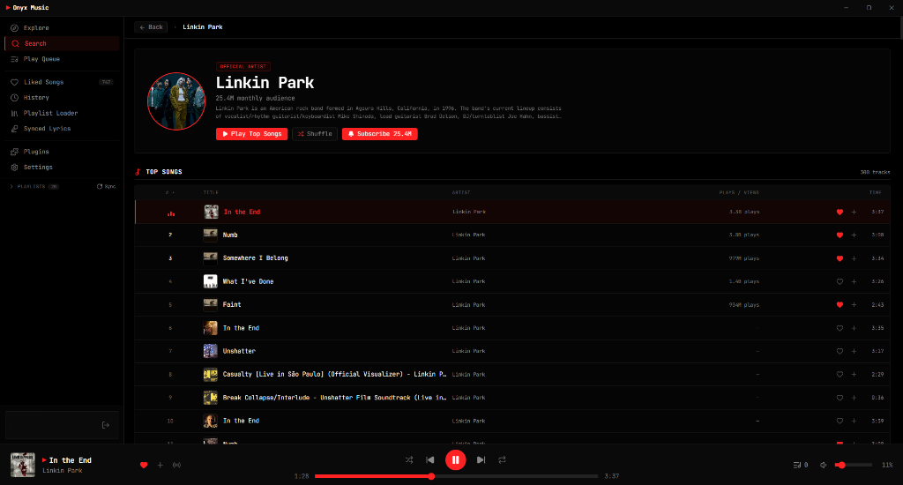

<p align="center">
  
</p>

<h1 align="center">Onyx Music</h1>

<p align="center">
  <a href="https://readme-typing-svg.demolab.com">
    
  </a>
</p>

<p align="center">
  <a href="https://skillicons.dev">
    
  </a>
</p>

<p align="center">
  <a href="https://github.com/MarianQQQ/Onyx-Music/releases"></a>
  <a href="https://tauri.app/"></a>
  <a href="https://www.rust-lang.org/"></a>
  <a href="https://www.solidjs.com/"></a>
  <a href="LICENSE"></a>
</p>

<p align="center">
  
</p>

<p align="center">
  
</p>

<p align="center">
  
</p>

## ⚡ Instant Download

<table>
  <tr>
    <td align="center" width="50%">
      <h3>📦 Windows Setup Installer</h3>
      <p>Clean installer with Start Menu integration and automatic uninstaller.</p>
      <a href="https://github.com/MarianQQQ/Onyx-Music/releases/latest/download/Onyx-Setup.exe">
        
      </a>
    </td>
    <td align="center" width="50%">
      <h3>🚀 Portable Binary</h3>
      <p>Single standalone executable ready to run anywhere without installation.</p>
      <a href="https://github.com/MarianQQQ/Onyx-Music/releases/latest/download/Onyx-Music.exe">
        
      </a>
    </td>
  </tr>
</table>

<p align="center">
  <a href="https://github.com/MarianQQQ/Onyx-Music/releases"><b>View All Releases & Changelogs &rarr;</b></a>
</p>

<p align="center">
  
</p>

## 💡 Inspiration & Roots

Onyx combines the best ideas from two open-source projects:

* **[th-ch/youtube-music](https://github.com/th-ch/youtube-music)** *(Pear Desktop)*: The benchmark for desktop GUI completeness and rich plugins (SponsorBlock, Last.fm scrobbler, synced lyrics, Discord RPC).
* **[peternaame-boop/ytm-player](https://github.com/peternaame-boop/ytm-player)**: The benchmark for extreme speed, minimal resource usage (~20 MB RAM), and zero background bloat.

**The Onyx Synthesis:** Rich desktop GUI and plugin ecosystem with CLI-grade lightness via native **Tauri v2**, **Rust 2024**, and **SolidJS**.

<p align="center">
  
</p>

## 🚀 Performance Benchmarks (Real Telemetry)

| Metric | Electron Wrappers | **Onyx Music (Measured)** |
| :--- | :---: | :---: |
| **App UI Process RAM** | ~450 – 700 MB | **~48.5 MB** |
| **Total Memory (with GPU & Sandbox)** | ~650 – 900+ MB | **~211 MB** |
| **Playback CPU Load** | 3.5% – 6.0% | **~1.5% – 1.9%** |
| **Idle CPU Load** | 1.0% – 2.5% | **0.0%** |
| **Cold Startup Time** | ~4.0s – 5.5s | **< 0.8s** |
| **Binary Bundle Size** | ~180 MB | **~6 MB** |

<p align="center">
  
</p>

## ✨ Highlights & Features

- 🎛️ **Native Audio Pipeline & DSP**: Direct WASAPI stream, 3-band parametric EQ (Low-Shelf, Mid, High-Shelf), and dual-slot gapless A/B crossfade.
- ⚡ **Massive Virtualization**: Smooth 60 FPS scrolling through 3,000+ tracks with constant low memory usage and zero DOM stutter.
- 🔀 **Contextual Playback & Smart Queue**: Isolated manual queue that never breaks your album/liked flow; true Fisher-Yates shuffle across your entire library.
- 🎤 **Interactive Synced Lyrics**: Sub-millisecond LRCLIB integration, click-to-seek, and 1-click `Alt + Click` real-time sync calibration.
- 🔌 **Built-in Plugin Ecosystem**: Built-in SponsorBlock (skips video sponsor segments & intros), Last.fm scrobbler, Discord Rich Presence, and native toast alerts.
- ⌨️ **Global Hotkeys & Media Controls**: Control playback, skip tracks, and fine-tune volume from anywhere in Windows even when gaming or minimized.
- 🛡️ **AI & Spam Filter**: $O(1)$ heuristic regex scanner filters AI voice clones, fake tracks, and automated remix re-uploads.
- 🔐 **Privacy-First Local Auth**: Credentials stay strictly on your device; direct communication with YouTube InnerTube endpoints.

<p align="center">
  
</p>

<details>
<summary><b>⚙️ Build from Source (Developer Guide)</b></summary>
<br>

```bash
# 1. Install dependencies
pnpm install

# 2. Run dev server with Hot Module Replacement
pnpm tauri dev

# 3. Build optimized release binary
pnpm tauri build
```

</details>

<br>

## ⚠️ Known Issues

* **Lyrics Desync**: Occasional timing offset between community-sourced LRCLIB timestamps and specific YouTube audio versions. You can instantly calibrate the offset in real time using `Alt + Click` on the current lyric line.
* **Bug Reports**: Encountered a glitch or have a suggestion? Please [open an issue](https://github.com/MarianQQQ/Onyx-Music/issues) on GitHub.

<br>

## 📄 License & Disclaimer

* **License**: Distributed under the [MIT License](./LICENSE).
* **Disclaimer**: Independent open-source project, not affiliated with Google LLC or YouTube.

---

<p align="center">
  <sub>Engineered by <b><a href="https://github.com/MarianQQQ">MarianQQQ</a></b> &amp; <b>Google Gemini</b></sub>
</p>
